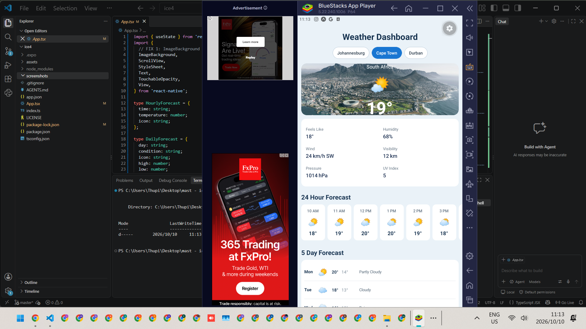

# ICE Task 4: Weather Dashboard and UI Debugging

**Name:** Kgopotso Thupi
**Student number:** ST10530092
**Module:** MAST5112 (Mobile Application Scripting)
**Repository:** https://github.com/ST10530092/mast5112-ice4

---

## 1. Introduction

The Weather Dashboard is a React Native app that shows hardcoded weather information for three South African cities: Johannesburg, Cape Town and Durban. The user selects a city and the dashboard shows the current weather over a background image, a set of detail values (feels like, humidity, wind, visibility, pressure and UV index), a 24 hour forecast, a five day forecast, and Sun and Moon information.

The supplied `App.tsx` contained intentional errors in its imports, city selection, image handling, data display, list rendering and layout. In this task I examined the code, identified each error, corrected it, and tested the corrected application. I did not redesign the app, and all of the code remains in `App.tsx`.

---

## 2. Development Environment

| Item | Details |
|------|---------|
| Framework | Expo (SDK 57) |
| Library | React Native |
| Language | TypeScript |
| Project template | `expo-template-blank-typescript` |
| Editor | Visual Studio Code |
| Machine | Personal Windows PC |
| Emulator | BlueStacks 5 |
| Test app | Expo Go (running inside BlueStacks 5) |

**Note on the environment:** the brief asks for the task to be completed in the institutional VM. BlueStacks 5 would not start in the VM because it failed with a "failed to initialise graphics backend for OpenGL" error, so I completed and tested the task on my own Windows PC instead, using the same tools (BlueStacks 5 with Expo Go).

The project was created with `npx create-expo-app@latest ice4 --template blank-typescript`. Dependencies were installed with `npm install --legacy-peer-deps`. The app was started with `npx expo start` and opened in Expo Go by connecting BlueStacks over ADB and entering the `exp://` URL manually, following the workflow from ICE Task 1.

---

## 3. Error Log

| # | Location | Problem | Error Type | Correction |
|---|----------|---------|------------|------------|
| 1 | Imports from `react-native` | `ImageBackground` was used in the JSX but was never imported, so the app could not compile or run. | Import / Compile | Added `ImageBackground` to the `react-native` import list. |
| 2 | City selector buttons | The buttons compared `selectedCity` with `weather.country` and called `setSelectedCity(weather.country)`. The app looks up weather by `city`, so tapping a button stored "South Africa", the lookup found nothing and the dashboard showed "Weather information unavailable". The selected button was also never highlighted. | Logic / State | Changed both the comparison and the `onPress` to use `weather.city`. |
| 3 | `ImageBackground` `source` | `source` was given a plain string (`selectedWeather.backgroundImage`). React Native needs an object with a `uri` for remote images, so the background image did not load. | Component property / Images | Changed to `source={{ uri: selectedWeather.backgroundImage }}`. |
| 4 | Humidity detail | The Humidity value used `selectedWeather.feelsLike`, so a temperature was displayed as a percentage. | Data / Wrong information | Changed to `selectedWeather.humidity`. |
| 5 | 24 hour forecast `ScrollView` | `horizontal={false}` made the hourly cards stack vertically instead of scrolling sideways. | Component property / Layout | Changed to `horizontal` so the hours scroll left to right. |
| 6 | Hourly forecast temperature | Every hourly card showed `selectedWeather.temperature` (the current temperature) instead of that hour's temperature. | Data / Wrong information | Changed to `hour.temperature`. |
| 7 | Five day forecast `.map` | The callback used curly braces without a `return`, so it returned nothing and no forecast days were displayed. | Array rendering / Syntax | Changed the braces to parentheses so the JSX is returned. |
| 8 | Five day forecast temperatures | The high temperature text displayed `day.low` and the low temperature text displayed `day.high`, so the values were swapped. | Data / Wrong information | Swapped them so the high style shows `day.high` and the low style shows `day.low`. |
| 9 | Sunrise detail | The Sunrise value used `selectedWeather.sunset`, so sunrise and sunset showed the same time. | Data / Wrong information | Changed to `selectedWeather.sunrise`. |
| 10 | `WeatherDetail` component | The value text rendered `{label}` instead of `{value}`, so every detail showed its label twice and no real values were visible. | Object properties / Component | Changed to render `{value}`. |
| 11 | `detailItem` style | `width: '100%'` made each detail fill a whole row, so the details were not laid out in a two column grid. | Style / Layout | Changed to `width: '48%'`, and gave `sunMoonCard` `flexDirection: 'row'`, `flexWrap: 'wrap'` and `justifyContent: 'space-between'` so it uses the same grid. |
| 12 | `dailyCard` style | `flexDirection: 'column'` stacked the day, icon, temperatures and condition vertically. The widths set on those items show they were meant to sit side by side in one row. | Style / Layout | Changed to `flexDirection: 'row'` with `alignItems: 'center'`. |

---

## 4. Testing

I tested the corrected application in the BlueStacks 5 emulator using Expo Go.

| Test | What I did | Expected result | Result |
|------|-----------|-----------------|--------|
| 1. Initial application | Launched the app | Dashboard displays, organised, with no errors | Passed |
| 2. City selection | Selected Johannesburg, Cape Town and Durban in turn | City name, current weather, background image and all forecast data change to match the selected city, and the selected button is highlighted | Passed |
| 3. Hourly forecast | Scrolled the 24 hour forecast sideways for each city | 24 hourly cards with time, icon and that hour's temperature | Passed |
| 4. Five day forecast | Inspected the five day forecast for each city | Five days, each with day, icon, high, low and condition | Passed |
| 5. Sun and Moon | Inspected the Sun and Moon section for each city | Sunrise, sunset, moonrise, moonset and moon phase all display, and sunrise differs from sunset | Passed |
| 6. Complete interface | Scrolled through the whole app | All sections visible and the layout is usable | Passed |

Before the corrections, the app could not compile because `ImageBackground` was not imported. Even after the import was fixed, tapping a city showed "Weather information unavailable", the five day forecast was empty, and every detail showed its label instead of a value.

---

## 5. Screenshot

The screenshot below shows the completed Weather Dashboard running in the BlueStacks 5 emulator with Expo Go.

---

## 6. Conclusion

This task taught me that user interface bugs often have small causes with large visible effects. A missing import stopped the whole app, comparing the wrong property broke city selection, and a pair of curly braces without a `return` made an entire forecast section disappear without any error. I also learned to check that the data shown matches the data supplied, because values such as humidity, sunrise and the high and low temperatures were silently wrong. Layout properties such as `horizontal`, `flexDirection` and `width` changed how whole sections looked. Testing each city and each section one by one was the most reliable way to find these problems, and keeping an error log made it easier to explain what was wrong, why, and how I fixed it.
